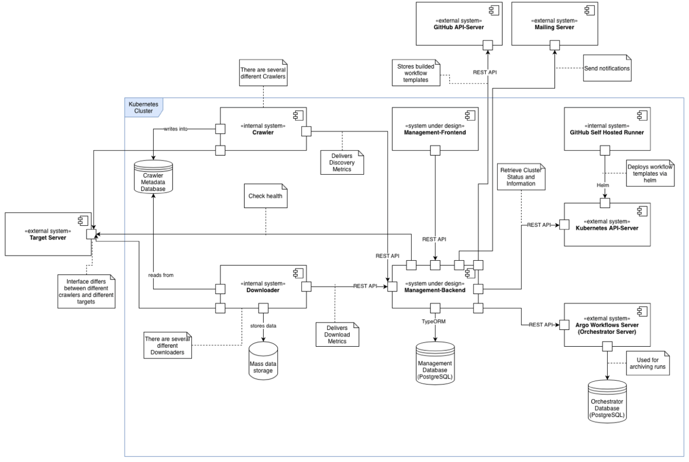

# 3. System Scope and Context

The context view shows how the system to be developed is embedded in its environment. It represents the system as a
black box and shows its external interfaces as well as adjacent systems.
The goal of this representation is to clearly limit the responsibilities of the system to be developed and to illustrate
dependencies on other systems (Starke & Hruschka, n.d.).
For the representation, the orchestration framework Argo Workflows is assumed as an example.

At the center of this architecture documentation are the Management Frontend and the Management Backend, which together
form the Crawler Management System. In addition, there are other systems that are partly within the project's sphere of
influence or external systems outside of it.

*(Figure 1: Context View)*

### Management Backend

The Management Backend represents the central component of the system and interacts with various other systems.
The main tasks of the backend include:

- Providing an API for the Management Frontend
- Managing users, schedules, runs, and metrics
- Communicating with the orchestrator's server (e.g., Argo Workflows)

In addition, the Management Backend acts as an abstraction layer between the specifically used orchestration framework
and the Management Frontend.

### Management Frontend

The Management Frontend is the only user interface for controlling and monitoring the crawlers. It interacts exclusively
with the Management Backend.

### Management Database

The Management Database is a PostgreSQL database used to store data managed by the Management Backend.

### Argo Workflows Server (Orchestrator Server)

In this representation, the Argo Workflows Server stands in for the entire orchestrator, which also runs within the
Kubernetes cluster.
The Management Backend communicates with the Orchestrator Server, for example, to query data about runs or create
schedules.
In the case of Argo Workflows, a separate database is additionally required to persist completed runs, for which a
PostgreSQL database is used.

### Crawler

There are several different crawlers, for example for different interface types, such as Representational State
Transfer (REST) APIs or File Transfer Protocol (FTP) servers.
The crawlers are developed within the scope of the project itself and are therefore generally within the system's sphere
of influence. Nevertheless, the crawlers should be developed independently of the management system, which is why only
the interfaces between crawlers and the Crawler Management Backend are specified (Requirement A1.3).
The crawlers deliver metrics and events to the Management Backend.

### Downloader

In this project, downloading the payload data is not the task of the crawlers themselves, but is taken over by a
separate component, hereafter referred to as the Downloader. This downloader reads the metadata from the Crawler
Metadata Database and subsequently downloads the payload data from the target servers into a mass data storage (e.g.,
AWS S3 bucket). The download functionality could theoretically also be part of the crawler. However, this is irrelevant
for the Management Backend as long as the defined interface is addressed.

### Crawler Metadata Database

The Crawler Metadata Database is populated by the crawlers with metadata about the discovered datasets. The Downloader
then reads these and subsequently downloads the associated payload data from the target servers.
The specific technology or internal structure of the database is not relevant to the management system.

### Target Server

The Target Servers represent the external servers where the payload data is located. The Target Servers are addressed
both by the crawlers to collect the metadata, and by the downloaders for the subsequent download. In addition, the
Management Backend addresses the Target Servers to check their availability (Requirement C1.3).

### Kubernetes API Server

The Kubernetes API Server represents the interface to the cluster.
The Management Backend accesses it exclusively in read-only mode to check the cluster's health status (Requirement B1.1)
and to obtain information about the cluster, such as its utilization (Requirements C1.1, C1.2, C1.4, C4.1). In addition,
the API Server is used within GitHub Action Workflows via Helm to automatically deploy the application itself as well as
the workflow templates (Requirements A1.1, A3.1).

### GitHub Self-Hosted Runner

The GitHub Self-Hosted Runner is required for deployment, as the Kubernetes cluster is only accessible from the
university network of the Friedrich-Alexander-Universität (Requirements A1.1, A3.1, Constraints R4, R5).
It is used within the GitHub Actions Workflows to deploy into the cluster.

### GitHub API Server

The GitHub API Server is required to synchronize crawler templates created via the UI into the GitHub repository to
ensure the versioning of the templates (Requirement C3.4 (A3.1)).

### Mailing Server

The Mailing Server is required to send alerts to users (Requirements C1.4, C3.5, C4.4).
