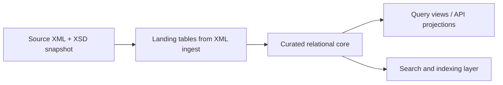

# 10. Implementation Details

This chapter describes selected aspects of the implementation of the developed system. However, since the total scope of
the codebase encompasses more than 80,000 lines, only central implementation decisions and special concepts are
discussed here.

## 10.1 Management Backend

### 10.1.1 Authentication and Authorization

The implementation of authentication and authorization in combination with fine-grained permissions management requires
comprehensive logic. The goal here was to centrally encapsulate this logic and thus clearly separate it from the actual
business logic, following the principle of separation of concerns, which significantly improves both the maintainability
and the extensibility of the system.
For this purpose, an Auth Service, authentication strategies for various authentication methods, an Ability Factory for
translating permissions, as well as guards and decorators for easy integration into the NestJS request flow were
implemented.

#### Auth Service

The Auth Service provides all functionalities for authenticating users as well as external systems, thereby
encapsulating both Bearer Token and API key management and generation.

**User Registration and Login:**
A method expecting the user's username and password serves to register a new user. The user's data, including the hashed
password, is then stored in the database via the Users Service. The newly created user initially receives the `PENDING`
status and first requires approval by an administrator before access to the application is granted. This ensures that
only authorized persons gain access to the application, yet not all users have to be created manually by an
administrator (see User Workflow).
For user login, a method is also offered that first validates the provided user credentials. For this, the corresponding
user is loaded from the database via the Users Service, and the password is subsequently checked for a match. If the
user does not exist or the credentials are invalid, the application returns the HTTP error code `401`. If the user
exists but is not in the `ACTIVE` status, the HTTP status code `403` is returned, thereby rejecting the request.
Upon successful authentication, a JSON Web Token (JWT [^1]) is generated using the NestJS JWT Service and a JWT secret
passed via environment variable. This token is valid for 30 minutes and is attached to the response object as an
HTTP-only cookie. This prevents access via client-side JavaScript and significantly reduces the risk of a Cross-Site
Scripting (XSS) attack (see Authentication and Authorization).
Finally, the user's authorization rules (Ability Rules) are created using the Ability Factory (introduced below) and
returned together with other user data.

**External Systems:**
As already described in the architecture chapter, API keys are used for the authentication of external systems. An API
key is a unique secret alphanumeric code that serves to authenticate communication with an interface. Only users with
the necessary permissions can create such an API key. A generated API key is then deposited, for example, for a crawler
to communicate with the crawler management backend.
To generate an API key, a method is offered that expects the creating user as well as a description. Thereupon, the
system generates a random API key, which is stored hashed in the database and subsequently returned once in plain text.
A repeated request for a full API key is not possible for security reasons. If the API key is lost, it should be
deactivated via a method offered for this purpose, and a new API key should then be created.
To validate an API key, a method serves that first receives it, hashes it, and subsequently compares it with all active
stored API keys. If a corresponding entry exists in the database, the associated API key object is returned, and the
date of the API key's last use is updated in the database. Otherwise, `null` is returned.
Furthermore, a method is available that returns all API keys, including their metadata. For security reasons, only a
prefix of 16 characters of the key is returned.

#### Authentication Strategies

The actual authentication logic is largely handled by PassportJS and integrated via specific strategy classes.
For JWT authentication, the token is first extracted from the request and subsequently passed to the constructor of the
Passport base class together with the secret key defined as an environment variable.
Within the `validate` method, the User ID is read from the token, and the corresponding user is loaded via the Users
Service. Should the user not exist or not have the `ACTIVE` status, the HTTP status code `401` or `403` is returned.
A separate strategy also exists for API key authentication. Here, the PassportJS base class constructor is called with
the key of the Authorization header, which should contain the API key. In addition, there is a method that validates the
API key appropriately using the already described validation method of the Auth Service.

#### Ability Factory

The Ability Factory represents the core of fine-grained permissions management and is responsible for converting a
user's permissions stored in the database into a CASL Ability object.
For this, a method is defined that receives the User entity, which contains an array of User Permission values. The User
Permission enum represents a single permission. These permissions are translated into CASL rules. The CASL rules consist
of a combination of Actions and Subjects, where Actions describe possible operations and Subjects represent the resource
types on which these operations can be executed. A data structure for mapping is defined for converting User Permissions
into CASL rules.
The method's return value is an Ability object, with the help of which a user's permissions can be easily checked.

#### Auth Guards and Decorators

Authentication and authorization represent cross-cutting concerns and must be checked before the execution of any
business logic.
Usually, these checks should be performed before the execution of the request handler so that the associated methods are
not even called if the user is not logged in or has insufficient permissions.
This is defined via decorators and guards. Decorators serve exclusively to define metadata and do not contain their own
logic.
The actual checking logic is implemented in the guards, which are called before the execution of the request handler and
are bound to the respective endpoints via annotations.

**Authentication:**
Two different guards are defined for authentication. One for authentication via Bearer Token and one for API key-based
authentication. Both guards use the Auth Guard implementations provided by PassportJS for this. Since both the JWT and
the API key are part of the request, no additional decorator is necessary.
For use cases that require information about the currently authenticated user, a Current User decorator was implemented,
which extracts the user from the request and provides it to the correspondingly annotated endpoint.

**Authorization:**
For the permissions check, a Require Permission decorator is defined, which receives the Action and the Subject to be
checked as parameters and provides them as metadata.
The actual check then takes place in the Permission Guard, which implements the `CanActivate` interface. Within the
`canActivate` method, the metadata provided by the decorator are first read out via a reflector. Subsequently, the user
is extracted from the request, and the user's Ability object is created using the Ability Factory. Based on this, the
application checks whether the user has the necessary rights to execute the action on the desired resource type. If yes,
`true` is returned; otherwise `false`, whereby the request is aborted with the HTTP status code `403`.
The registration of the guards takes place via the `UseGuards` decorator provided by NestJS at the respective endpoint.
For the Permission Guard, the annotation of the Require Permission decorator is additionally required to define the
permissions to be checked.

Centralizing authentication and authorization logic achieves a clear separation between security logic and business
logic, which significantly improves both the consistency of the implementation in terms of conceptual integrity and the
associated maintainability of the application.

### 10.1.2 Implementation of the Logging Strategy

When implementing the logging concept described in the architecture, a central implementation was sought where possible.
This is intended to ensure consistent log messages and keep maintainability and development effort as low as possible.
Because of this, several components were developed that take over central aspects of the logging strategy, such as
logging database operations, incoming and outgoing API requests, as well as occurred errors.
All other aspects of the described logging strategy must be implemented respectively at the places where the events
occur, since, among other things, further context is needed for the log message.

**Logging of Database Operations:**
An implemented logger class that implements the `TypeOrmLoggerInterface` (thereby utilizing the logging hooks provided
by TypeORM) takes over the logging of database operations. The implemented logger is thus automatically called for all
relevant events and thereupon creates corresponding log entries using the NestJS logger. Executed database queries as
well as log events of the `INFO` category are output by the logger as debug logs. Other log types are mapped to the
corresponding logging method of the NestJS logger.
If an error occurs during the execution of a database query, the application outputs the associated query as an error
log in addition to the error message to provide additional context for the analysis.
The registration of the implemented logger class takes place in the DB Config Service so that TypeORM uses it
automatically.

**Logging of Incoming API Requests:**
A central NestJS interceptor takes over the logging of incoming API requests. This interceptor is automatically called
for all incoming API requests and creates log entries with all essential information.
It logs the called URL, the ID of the calling user, the passed request data, as well as the HTTP response code and the
duration of processing the request.
Before the request body is added to the log entry, sensitive information is anonymized using a method described below,
so that no security-relevant data such as passwords or API keys are contained in the log files.

*(Figure 28: Logging of incoming API requests)*

**Logging of Outgoing API Requests:**
In addition to incoming API requests, the application also logs outgoing requests. Another interceptor was implemented
for this purpose.
Due to the use of different Axios instances in various components, the interceptor must be registered when initializing
the corresponding component, and the used Axios instance must be passed.
The interceptor then intercepts all outgoing requests as well as their corresponding responses and creates corresponding
log entries. For each request, the log entry contains, among other things, the target URL as well as the request data.
Here too, sensitive data is removed using the method described below.
For all responses, the HTTP response code as well as the duration of the request and, in case of an error, the error
message goes into the log.

*(Figure 29: Logging of outgoing API requests)*

**Handling Sensitive Data:**
As already described, a method was implemented that removes security-relevant information from objects.
The objects are checked recursively against a list of sensitive parameter names to be anonymized. If a corresponding
parameter is recognized, it is replaced by a placeholder so that no sensitive information whatsoever is contained in the
logs.

**Logging Errors:**
A global Error Interceptor handles all uncaught errors during the processing of requests.
It first evaluates the status code and outputs only logs of the `warn` category for client-side errors (4xx range).
These can often be traced back to incorrect requests from the user, such as querying an already deleted run.
All other errors are logged as severe errors with the log level `error`. Here, the log entry additionally contains the
stack trace as well as the identifier of the requesting user to support the analysis.

*(Figure 30: Logging of errors)*

### 10.1.3 Targets

To be able to check the reachability of the crawlers' target URLs, these must first be stored. Targets represent the
parameters defined within the scope of schedules that relate to the target URL of crawlers. Their availability should be
checked regularly.
The persistence of the targets takes place in a separate database table. A relational link also exists between targets
and schedules, which is mapped via a separate database table. This table is necessary because a schedule can have
multiple targets and a target can also occur in multiple schedules.
During the creation of a schedule, the Schedules Service checks all parameters based on their name to see if they define
a target. All these parameters are then passed to the Targets Service, which checks whether the URL is valid and whether
it already exists in the database. If the URL already exists, the method returns the existing target object from the
database. Otherwise, a new target object is created in the database and is subsequently returned.
The collected targets of the schedule are then referenced in the Schedules Service when saving the schedule in the
database.
When updating a schedule, all parameters must also be checked again for target URLs. Here, the Schedules Service
compares the newly recognized targets with the targets previously assigned to the schedule. If changes occur, new
targets are created via the Targets Service, and removed targets are passed to the Targets Service for deletion.
However, deletion only takes place there if they are no longer assigned to any other schedule. The same thing happens
when deleting schedules.

### 10.1.4 Health

For the health status check, a distinction must be made between the system status and the status of individual target
URLs.

**Health Status of the System:**
The system status consists of the status of the orchestrator and that of the Kubernetes cluster.
To determine the orchestrator status, the Health Service queries an endpoint of the orchestrator server via the
Orchestrator Client. If an error of the HTTP category 4xx occurs during the request, the system status is returned as
`LIMITED`. This is because this error category describes client errors, which means the error is likely in the crawler
management, but some functions might still be executable. If, however, an error of the category 5xx or another
unexpected error occurs, the method returns the `DOWN` status. If the request is successful, the status is set to
`AVAILABLE`.

The status of the Kubernetes cluster is determined using the Kubernetes Client. First, it queries all nodes of the
cluster. If no node is available, it returns the `DOWN` status.
The Kubernetes Client method individually checks the state of all found nodes. If at least one node is not in the
`Ready` state or if Memory, Disk, or PID Pressure occurs, the overall state of the cluster is evaluated as `LIMITED`, as
resource bottlenecks impair the stability of the system.
Subsequently, all pods of the crawler management are checked. If a pod is terminated or not in the `Ready` state, the
method also returns the `LIMITED` status, because even if not all pods are running, parts of the system or even all of
them can still function, just under lower load.
If, however, an error occurs in one of the requests to the cluster, the method returns the `DOWN` status.
If all checks are successful, the method returns the `AVAILABLE` status.

**Health Status of the Target URLs:**
The Health Service checks the status of the target URLs individually per URL based on their reachability.
For this, the Targets Module provides all targets that reference at least one unpaused schedule, so that only currently
relevant targets are checked. Then, a helper method checks for each URL whether it is reachable. This attempts to send a
request to the respective URL. If an error of the HTTP category 5xx occurs, the method returns the `DOWN` status for
this URL. If an error of the category 4xx occurs, the status is evaluated as `LIMITED`, as this could also be due to
missing access rights, for example.
If requested successfully, it returns the `AVAILABLE` status.
If another error occurs, such as a timeout of the request, the request is repeated after a delay. Should this attempt
also fail, the method returns the `DOWN` status.

### 10.1.5 Orchestrator Synchronization

As already described in the Architecture Decisions chapter, a regular synchronization process between Argo Workflows and
crawler management is required regarding the schedules. On the one hand, it must be ensured that the schedules present
in the orchestrator match the locally persisted schedules. On the other hand, it must be regularly checked whether the
parameters provided by a schedule still match the parameters expected by the referenced template.

The Orchestrator Sync Module is responsible for both of these functionalities.
For this, the module implements the `onModuleInit` and `onModuleDestroy` interfaces.
Upon module initialization, two independent intervals are started: one to synchronize the schedules between the
orchestrator and crawler management, and one to check for inconsistencies between schedules and templates. When the
module is destroyed, these intervals are terminated to avoid resource leaks.

**Schedule Synchronization:**
For schedule synchronization, the method first queries all schedules from the orchestrator via the Orchestrator Client
and then passes them to the Schedules Service.
The Schedules Service then builds a map data structure from all locally stored schedules, where the key consists of the
concatenation of name and namespace, and the respective schedule is defined as the value. This approach serves efficient
processing because it allows quick access to individual schedules without the need to iterate over all schedules.

Subsequently, a helper method checks for each schedule whether it is stored in the local database. If this is not the
case, it is persisted in the database and a warn log is written, as schedules should exclusively be created via the
crawler management application. If the schedule already exists, the locally stored data for the schedule are compared
with those from the orchestrator and updated if necessary. The method also writes a warn log in case of changes, since
changes to the schedule should also exclusively be made via the crawler management system.
Then, a check of the target parameters takes place. New targets are passed to the Target Service for saving, and removed
targets are cleared for possible deletion.
Finally, the schedule is removed from the local map and thus marked as synchronized.
After all schedules provided by the orchestrator have been processed, the map only contains those schedules that exist
locally but are no longer present in the orchestrator. These are deleted from the local database, as the orchestrator is
considered the leading system in case of inconsistencies.

**Detecting Inconsistencies Between Schedule and Template:**
The second periodically executed routine serves to detect possible inconsistencies between a schedule and its referenced
crawler template. First, the Orchestrator Sync Service queries all locally stored schedules from the Schedules Service.
For each schedule, a helper function checks it for inconsistencies and sets or removes corresponding error messages.
Different error types were defined to categorize errors. Currently, there is an error type for non-existent templates
and one for parameter inconsistencies.
First, the helper method queries the orchestrator for the referenced template of the schedule via the Orchestrator
Client. Should it not find it, a missing template type error is set via the Schedules Service.
If the template exists and a missing template type error is set, this is removed again, since the template now exists.
Subsequently, the method checks whether the template's version matches the version in the stored schedule. If yes, the
check for this schedule is not necessary and thus finished, as the template has not changed since the last check. If,
however, the versions do not match, the associated schedule stored in the orchestrator is retrieved via the Orchestrator
Client, as the parameters are only stored there. Based on this, a helper method now compares the parameters of the
schedule with those of the template and, in case of inconsistencies, sets corresponding parameter inconsistency error
messages for the schedule via the Schedules Service. However, if no inconsistencies are found, all errors of this type,
if existent, are removed from the schedule.
Finally, the parameter in the schedule for the last checked template version is set.

For both routines, it is ensured that the previous execution has already finished before a new execution starts.

### 10.1.6 Schedules

**Schedule Engine:**
To create and modify schedules, specific logic is needed, especially when using Argo Workflows as the orchestrator.
Argo Workflows defines schedules as so-called Cron Workflows. A Cron Workflow references a workflow or crawler template
and defines, besides the temporal execution, things like retry mechanisms and parameters. The definition of a Cron
Workflow takes place in YAML format.
The developed Argo Schedule Engine encapsulates this logic; it implements the Schedule Engine Interface with methods for
creating and modifying schedules.
The method for creating a schedule receives an object with all relevant schedule data, as well as the creating user for
documentation purposes. Based on the passed parameters, it then builds a schedule object using the Argo Cron Workflow
Builder and subsequently converts it into a YAML document. It finally passes this to the Argo Client Service for
transmission to the Argo Server.
The method for modifying a schedule expects the name and namespace of the schedule as well as the parameters to be
changed. The existing Cron Workflow is fetched via the Argo Client Service, adapted according to the passed parameters,
converted again into a YAML document, and finally passed back to the Argo Client Service for transmission to the Argo
Workflows Server.

**Argo Cron Workflow Builder:**
The Argo Cron Workflow Builder serves to construct the complex Cron Workflow object for Argo and abstracts the complex
logic.
First, it sets some basic fields of the object with fixed values, such as Argo's API version or the type of the object (
Cron Workflow). Various methods subsequently set specific fields, like name, namespace, or the cron expression including
time zone.
Where necessary, appropriate validations are also performed here, such as when setting the retry strategy, so that no
negative time values can be set.
The `build` method finally returns the completely constructed object, checking whether all required fields are set and
otherwise throwing corresponding exceptions.

### 10.1.7 DB Config Service within Migrations

As already described in the architecture chapter, TypeORM Migrations are used for database changes. A migration file
that ensures the migrations are generated with the identical configuration the application itself uses serves as an
entry point for the migration scripts.
First, a validation of the required environment variables takes place in the migration file. Subsequently, a Config
Service is created with the validated variables. Using the DB Config Service, a DataSource object is created and
exported for TypeORM.
The DB Config Service described just above implements the `TypeOrmOptionsFactory` and returns the concrete TypeORM
DataSource options. Here, the database credentials are read from the Config Service provided by the migration file, and
further configuration parameters, such as logging options or migration behavior, are set.
The definition of the entities to be considered also takes place during this configuration.
If a new database table is needed and therefore an entity is created for it, it must be added here. Subsequently, the
migration command can be executed, generating a corresponding migration file. After manually reviewing it, it must also
be added to the DB Config Service. As a result, it is automatically applied to the database upon the next start of the
application. Migrations that have already been executed are documented in a separate database table.

### 10.1.8 Validation of Environment Variables

For a stable operation of the application, it is important that the required environment variables are present and
correct.
To this end, a validation component is executed at the start of the application, which validates all required
environment variables, generates an appropriate error message if necessary, and in this case subsequently aborts the
application startup. This prevents configuration errors regarding environment variables from surfacing only at runtime
in individual spots. Because this would make traceability significantly more difficult and also massively impair the
stability of the system. Instead, the application does not start at all, making a misconfiguration immediately
noticeable.

### 10.1.9 Argo Client

**Argo Auth:**
For the crawler management backend's authentication towards the Argo Workflows Server, a special logic is necessary
because the authentication mechanism differs depending on whether the backend runs inside the cluster or locally for
testing and development purposes.
According to the Single Responsibility Principle (Martin, 2003, p. 95), a class should only have one responsibility,
which is why the authentication logic for Argo was outsourced to a separate class.
A helper method defined for this first determines based on the `Stage` environment variable whether the application runs
in the cluster.
If the application runs in the cluster, the injected Service Account token is read from the container's file system. The
application was previously assigned a role via Helm that has the necessary permissions to retrieve the required data
from the Argo Workflows Server.
If the application runs locally, the token must be provided via an environment variable.
The retrieved token is then set as a Bearer Token in the Authorization header on every request to the Argo Workflows
Server, so that the Argo Client Service can fully concentrate on the business logic.

**Argo Query Param Builder:**
When querying data from the Argo Server, API parameters follow special structures, which is why this logic was relocated
to an extra class following the Builder Pattern.
First, a distinction is made between normal parameters and label parameters.
The definition of normal parameters with a single value takes place in standard query parameter form. If a parameter has
multiple values, these are separated by commas and not, as is normally usual, by setting the same parameter multiple
times. Label parameters are defined with the prefix `listOptions.labelSelector`.
A single value is passed in the form `parameter=value`. Multiple values are defined via `IN` syntax.
The following table clarifies the definition of query parameters for requests to the Argo Workflows Server.

*(Table 3: Argo Workflows Query Parameter Syntax)*

- **Normal Parameter Single Value**: `?{parameter}={value}`
- **Normal Parameter Multiple Values**: `?{parameter}={value1},{value2}`
- **Label Parameter Single Value**: `?listOptions.labelSelector={parameter}={value}`
- **Label Parameter Multiple Values**: `?listOptions.labelSelector={parameter} in ({value1}, {value2})`

To encapsulate this functionality through a dedicated class, the Builder Pattern is used, which serves to construct
objects incrementally, hiding details on how the object is created, represented, and assembled (Gamma, Helm, Johnson, &
Vlissides, 1993, p. 13).
The goal of the Builder class here is to construct an Argo-compatible query string. Internally, the builder manages a
map data structure for this, with a string as the key and an array of strings as the value.
Additionally, three methods are implemented:
The `add` method serves to add normal parameters, taking the parameter name as well as one or more values. It first
converts the values to strings and then adds them to the map. If a value already exists for the given key/parameter
name, the values are appended to it.
Another method is `addLabelSelector`, offering the functionality to add label parameters. It takes the parameter name
and any number of values for it. It then differentiates whether multiple values were passed or only one, and applies the
above-described syntax accordingly. Lastly, the assembled parameter string from parameter names and values is saved or
appended in the map under the key `listOptions.labelSelector`.
The `build` method ultimately generates the complete query string.
Through this abstraction, the Argo Client Service is prevented from having to deal with the syntactic particularities of
the Argo API, achieving a clear separation between API logic and business logic.

### 10.1.10 Authentication Towards Kubernetes

For the crawler management backend's authentication towards the Kubernetes API Server, a special logic is necessary
because the authentication mechanism differs depending on whether the backend runs within the cluster or locally for
testing and development purposes.
The authentication logic was here relocated to its own class, similarly to the authentication towards Argo.
First, a helper method checks based on the `Stage` environment variable whether the application runs in the cluster.
If the application runs in the cluster, the KubeConfig file is loaded from the cluster, which is handled by a Kubernetes
client library.
Upon local execution, the KubeConfig file is read from the path specified by the environment variable. Should this
variable not be set, an attempt is made to read it from a default path.
Subsequently, the method checks whether the KubeConfig file is valid by querying the associated server.
Finally, the Kubernetes Client library creates an API client based on the KubeConfig. The Kubernetes Client Service can
ultimately leverage the API client for requests.

### 10.1.11 Crawler Metrics

The Crawler Run Metrics Service builds the central component for managing and persisting crawler metrics and events. As
described in the architecture chapter, these data are sent from the crawlers to the crawler management backend and then
passed to the Crawler Run Metrics Service.
To persist the data, two database tables were created: one table to store metrics and one to store events.
Both tables use a composite key consisting of the name and the namespace of the run. Moreover, if provided by the
crawler, a reference to the schedule of the run is also stored.
For storing crawler metrics and events, the service provides several methods. It differentiates between metrics from
collecting datasets and downloading them, as they are typically sent by different modules of the crawler.
The persistence of the metrics occurs idempotently. This ensures that newly submitted values overwrite existing stored
numbers rather than incrementing them. This allows crawlers to repeatedly send metrics (e.g., in case of network
problems) without falsifying them.
Multiple methods are also offered for querying the stored metrics and events.
First, the metrics of a specific run can be loaded directly from the database. Second, a method is provided which
enables the retrieval of aggregated metrics of all runs within a schedule. Third, there is a method returning the
schedule's metrics grouped and summated per day spanning a specified time slice. The aggregation logic in both
configurations is executed efficiently straight on the database level through optimized queries, avoiding having to
fetch all runs directly into the container's memory first.
Lastly, an endpoint retrieves all recorded events belonging to a designated run.

### 10.1.12 XML Data Model Proposal

The XSD-to-Postgres generator in `xml_ingestor` is best treated as a landing layer, not as the final serving model. A more NCBI-like design keeps the raw XML source, extracts stable business entities into curated tables, and builds read-optimized projections on top.

#### Layer 1: Source Archive

The first layer stores the original input for replay and auditability.

- `source_document`: one row per XML file, with checksum, source URI, schema name, schema version, load time, and parser version.
- `schema_snapshot`: the resolved XSD set used for a load, including includes and imports.
- `ingest_batch`: the execution unit for one import run, with status, started/finished timestamps, and record counts.

#### Layer 2: Landing Tables

The generated tables from the XML parser remain useful as a durable landing zone for complex or sparse structures, but they should not be the primary API surface.

- One landing table per important XML subtree.
- Repeating groups stay normalized into child landing tables.
- XML attributes become columns in the same landing table.
- Raw XML fragments can be retained for fields that are too flexible to flatten safely.

#### Layer 3: Curated Core Tables

The curated schema should use stable biological concepts and accession-based identifiers rather than path-derived names.

- `project`: the central project record, keyed by a stable accession.
- `project_identifier`: archive-specific identifiers such as NCBI, EMBL, or DDBJ accessions.
- `project_type`: normalized project classification and subtype.
- `project_publication`: relation table between projects and publications.
- `publication`: bibliographic record with title, journal, year, DOI, PMID, and status.
- `publication_author`: ordered many-to-many relation between publications and authors.
- `author`: normalized person or consortium record.
- `organism`: organism-level entity with taxonomy and lineage information.
- `project_organism`: link table for project-to-organism relations when the source model allows multiple organisms.
- `sample`: the biological sample or target entity used in the experiment.
- `replicon`: chromosome, plasmid, or other replicon-level object.
- `replicon_part`: child rows for repeating or nested replicon details.
- `xref`: external database references and internal cross references.
- `controlled_term`: curated vocabulary values such as sample scope, material, capture, and phenotype categories.

#### Layer 4: Serving Projections

For application queries, the curated core should be exposed through projections instead of direct table scans.

- materialized views for common lookup patterns
- API-facing DTO projections for nested read models
- denormalized search documents for full-text search and faceted queries

#### Design Rules

The proposal follows a few rules that match the way large biological archives are usually structured:

1. Stable identifiers come from the domain, not from the XML path.
2. Repeated groups are modeled as child rows, not as repeated columns.
3. Source provenance is preserved end to end.
4. Curated tables are optimized for serving and joining, not for mirroring every XML branch.
5. The landing layer can be regenerated without losing the curated core.

This keeps the parser useful for loading NCBI-like data while avoiding a database that is permanently tied to the shape of one XSD file.

#### Domain-Agnostic First Pass

If the domain is still not well understood, the first serving layer should stay intentionally generic. The goal is to make the data queryable without pretending to know which structures are biologically important yet.

The initial projections can stay close to the source and use neutral names:

- `source_document`: the original XML document and its metadata.
- `entity`: one row per meaningful XML node or repeatable subtree.
- `entity_attribute`: flattened attributes and scalar child values.
- `relation`: parent-child or cross-reference links between entities.
- `identifier`: accession-like values, external IDs, and local IDs.
- `reference`: titles, URLs, citations, and other lookup-friendly references.
- `controlled_value`: enumerations, vocabulary values, and code-like fields.
- `load_batch`: import execution metadata and provenance.

This model is intentionally conservative. It gives you three useful properties:

1. You can serve and search the data before the domain model is finalized.
2. You can rename or split projections later without losing the raw landing data.
3. You avoid encoding wrong biological assumptions into the database too early.

#### Promotion Rules

Generic projections should only be promoted into named domain tables when at least one of the following becomes true:

- The same subtree appears in many records and is used in queries.
- The data represents a stable real-world concept rather than just XML structure.
- The field is used as a join key, accession, or external reference.
- The group has a clear semantic meaning that experts recognize.
- A user-facing API would otherwise have to expose an awkward generic shape.

Until then, keep the data in the landing tables or in generic projections. In practice, this means the system can start with a neutral model and gradually evolve toward a curated model as the schema and usage patterns become clearer.

## 10.2 Management Frontend

### 10.2.1 Auth Context

The Auth Context forms the central layer for authentication and authorization in the frontend, encapsulating the entire
application.
The Auth Context encapsulates all logic for fetching the active user profile, applying permission bounds, alongside
executing procedures for login, logout, and registration.
A global status relating to user details is essential to guarantee consistency between all components and thus prevent
contradictory states.
Therefore, the Auth Context establishes methods for login, logout, and registration, calling the respective endpoints in
the backend, whereupon the global user state is set.
To provision this state, a context variable is defined, which provides, for example, the current user, the loading
state, and an Ability object.
The information about the current user is queried by calling the `auth/me` endpoint in the backend. After a successful
login, the backend sets an HTTP-Only Cookie, which is saved in the user's browser and automatically sent along with all
subsequent requests.
The mentioned Ability object is used for checking permissions, exactly as described for the backend. It is created from
authorization rules defined in the backend and transferred to the frontend as part of the user data. Using this object
and the functions provided by CASL, it can be checked whether a user is authorized to perform a certain action on a
specific resource type. However, the client-side permission check never replaces the server-side permission check under
any circumstances.

### 10.2.2 Guards

**Auth Guard:**
A majority of the application's pages should be completely restricted to signed-in users. However, if each page
individually checked whether a user is logged in, this would lead to redundancy and associated increased maintenance
effort, potential inconsistencies, as well as breaching of conceptual integrity.
Therefore, a central Auth Guard was implemented, which acts as a parent wrapper enclosing the page components to be
rendered.
The Auth Guard fetches the global state from the Auth Context and checks whether a user is logged in and whether the
retrieval of user data is still in a loading state. As long as the user data is still loading, an appropriate message is
displayed. If the user is not logged in and the loading process is already finished, a redirect to the login page
occurs, and the user thus gets no access to this page. Providing a user is logged in, the passed child objects are
rendered and the page is displayed accordingly.
This central solution improves maintainability considerably, as changes to the authentication only have to be made in
one place. Furthermore, this implementation provides the user with consistent behavior across all pages of the
application.

**Permission Guard:**
The Permission Guard adopts a similar approach, since, as previously described, fine-grained permission management is
provided in addition to authentication. Thus, not every user should be able to access all pages of the application.
To also provide the permission check centrally, the Permission Guard was implemented. Analogous to the Auth Guard, this
also wraps the components to be displayed, but must always be wrapped by the Auth Guard itself, as a logged-in user is a
prerequisite.
The Permission Guard uses the passed Ability object and the passed required permissions to check whether the user holds
them. The check takes place using the `can` method of CASL.
If a user does not possess all required permissions, the Permission Guard denies them access and displays which
permissions they lack.
However, if the user owns the required permissions, the enclosed components are rendered, and the user does not notice
the Permission Guard.

**Can:**
However, not only entire pages should be protected against unauthorized access. For instance, a user could have the
permissions to see schedules, but not to modify them. The Permission Guard is unsuitable for this since it applies to
entire pages. For the desired functionality, CASL offers the `Can` component. This wraps one or more UI components and
expects the Ability object from the Auth Context as well as the required permissions. The component is only rendered if
the user holds the specified permissions.
In summary, it can be stated that by combining the Auth Context, Auth Guard, Permission Guard, and the components
provided by CASL, a consistent and centralized authentication and authorization logic was created, allowing core modules
to concentrate on their own business logic.

### 10.2.3 Utils

The frontend's `utils` directory accumulates various auxiliary functionalities. Some of these are described below as
examples.

**Cron Helper Functions:**
Since the definition of schedule timetables is done in Cron format, which is only readable with technical background
knowledge, two helper functions are defined.
On the one hand, a function exists that generates a human-readable format out of a Cron expression. Two libraries are
used for validation and conversion for this.
On the other hand, a function was implemented that calculates the next execution from a given Cron expression and its
time zone in relation to the current time and the user's time zone.
Another function calculates a descriptive text for a given Cron expression and associated time zone using two libraries,
converting the times defined by the Cron expression and its time zone into the user's local time. Both functions
therefore serve to offer the user easily readable information based on the Cron expression and to provide this
functionality centrally in one place so that redundant implementations are avoided.

**Time Interval Helper Function:**
Various chronological inputs are delivered in seconds, which, however, leads to values that are hard to interpret at
longer time intervals.
A central helper function resolves this problem by converting a given number of seconds into a user-friendly
representation. Depending on the magnitude, the values are displayed in seconds, minutes, hours, or days.

---

[^1]: https://www.jwt.io
